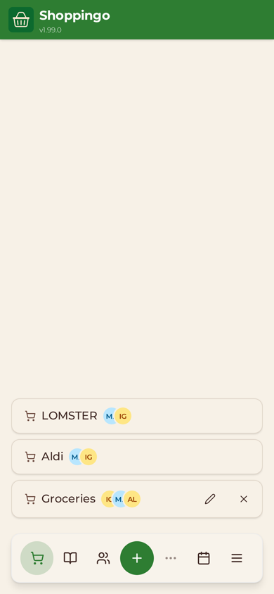
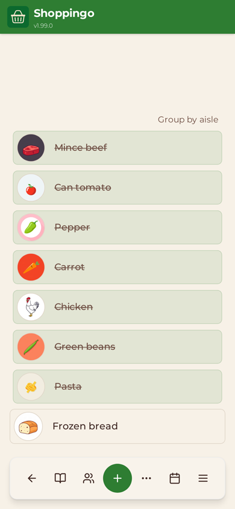
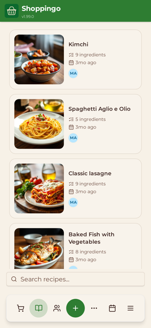
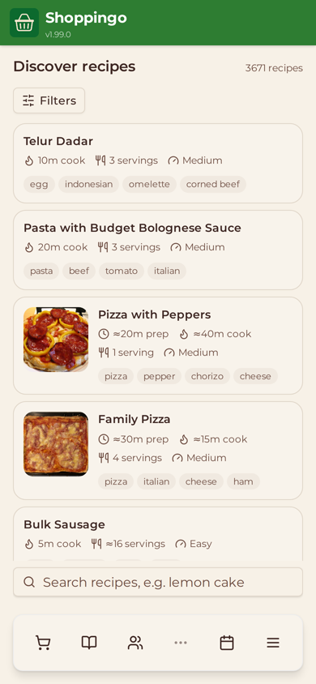

# Shoppingo

[](https://github.com/igor-siergiej/shoppingo/actions/workflows/pr.yml)

A shared shopping-list PWA built around how people actually shop: plan from
recipes, or just add things to a list — either way the list is one tap away in
the shop, works offline, and stays in sync with whoever you share it with.

**Live app:** https://app.tandra.uk
**Marketing site:** https://tandra.uk

<p align="center">
  
  
  
  
</p>

## Goal

Give a household one shared place to do the shopping together, so everyone stays organised. For home cooks, make it easy to discover new recipes and to keep their own recipes in one place where they are simple to maintain and keep track of.

## What it does

- **Two ways in.** Build a shopping list directly (list-first), or start from a
  recipe and push its ingredients onto a list (recipe-first). Recipes can be
  added by hand or **imported from a link** — an LLM extracts the ingredients and
  method, and you edit and confirm before it saves.
- **Meal calendar.** Schedule recipes across the week; the calendar feeds the
  list.
- **Sharing.** Add friends and share individual lists or recipes; members see
  changes live.
- **Installable PWA.** Add to home screen, works offline with queued writes that
  sync when you reconnect, and registers as an Android share target so you can
  send a recipe URL straight into the import flow.

## Architecture

Diagram of packages, runtime services, homelab deployment and external APIs:
[`docs/diagrams/architecture.excalidraw`](docs/diagrams/architecture.excalidraw)
(open in excalidraw.com or the VS Code Excalidraw extension).

Bun-workspace monorepo — `packages/web`, `packages/api`, `packages/types`
(shared interfaces and the Zod request schemas, `@shoppingo/types/schemas`).

- **web** — React 19 + TypeScript + Vite. Tailwind + Radix/shadcn UI, React
  Query for server state, React Router, react-hook-form + Zod for forms,
  `vite-plugin-pwa` (`injectManifest`, `src/sw.ts`) for the service worker /
  offline / share-target. Offline writes go to an IndexedDB outbox
  (`src/offline/`) and replay on reconnect. Built to static files served by
  nginx on `:3000` (`packages/web/nginx.conf`).
- **api** — Hono on Bun (`Bun.serve`, entry `packages/api/src/index.ts`, no
  build step — the image runs `src` directly) on `:4001`, in a
  clean-architecture layout: `domain/` (services, entities), `infrastructure/`
  (MongoDB repositories, object store, fal.ai clients, auth client, web push),
  `interfaces/` (HTTP handlers), `routes/`, `middleware/`, `dependencies/` (DI
  container). Prometheus metrics at `/api/metrics`, liveness at `/api/health`.
- **data** — MongoDB (native driver) is the system of record. Images live in
  S3-compatible object storage (RustFS) and are served through the api
  (`/api/image/:name`). OpenSearch holds an optional, derived index for
  Discover search; when `OPENSEARCH_URL` is unset `/api/discover/*` answers
  `503` and nothing else is affected.
- **auth** — built into the api with [Better Auth](https://better-auth.com) at
  `/api/auth/*`: username + password (argon2id), no email. The session is an
  httpOnly same-origin cookie, so the web sends no `Authorization` header; a
  `401` from the api signs the web client out (`auth:session-expired`). The
  last signed-in `{id, username}` is cached in `localStorage` so an offline
  launch still opens the app. The api still accepts kivo bearer tokens as a
  fallback until kivo is removed (jott #147).
- **realtime** — list members get live updates over a websocket at
  `/api/ws/lists/:title`. The browser first asks for a single-use ticket
  (`POST /api/lists/:title/socket-ticket`, 30 s TTL) because `WebSocket`
  cannot send an `Authorization` header. Fan-out (`ListRealtimeHub`) is
  in-process: events carry no state, clients refetch, and the api is assumed
  to run as one container.
- **notifications** — Web Push (VAPID) subscriptions under `/api/push/*`; a
  daily scheduler in the api sends todo reminders.
- **sharing** — friend codes, per-list/per-recipe members, and list invite
  links (`/api/lists/invites/*`).
- **AI** — everything goes through fal.ai with `FAL_KEY`: images via
  `fal-ai/flux/schnell` (`FalImageGenerator`), text via `fal-ai/any-llm`
  (`FalLlmClient`, default model `google/gemini-2.5-flash-lite`) for recipe
  tagging, substitutes, item aisles and spoken-item parsing. Recipe import
  is JSON-LD first, then HTML heuristics; the LLM is only a third tier when
  `RECIPE_IMPORT_LLM_ENABLED`, or the sole parser when
  `RECIPE_IMPORT_LLM_FIRST`. Outbound fetches of recipe pages and images go
  through the SSRF guard in `infrastructure/safeFetch.ts`. AI routes are
  rate-limited (`middleware/aiRateLimit.ts`).
- **Discover** — shared recipe library fed from the Wikibooks Cookbook and
  user-published recipes; public read-only `/api/public/discover/*` (CORS
  allow-list `PUBLIC_DISCOVER_ORIGINS`) feeds the marketing site. See
  [docs/](docs/README.md).
- **WebMCP** — three browser-agent tools registered from the web app; see
  [docs/webmcp.md](docs/webmcp.md).

## Configuration

Names only; `.env.example` has dev values and comments. The api reads its
env through `packages/api/src/config/index.ts` (fails at boot on a missing
required value).

| Variable | Required | Purpose |
|---|---|---|
| `PORT` | yes | api listen port (`4001`) |
| `CONNECTION_URI`, `DATABASE_NAME` | yes | MongoDB |
| `BUCKET_ENDPOINT`, `BUCKET_NAME`, `BUCKET_ACCESS_KEY`, `BUCKET_SECRET_KEY` | yes | S3-compatible object store (RustFS) |
| `AUTH_URL` | no | legacy kivo base URL for the bearer fallback; must be `https://`, except `http://kivo:<port>` (docker network) or `http://localhost` outside production (`config/auth-url.ts`) |
| `BETTER_AUTH_SECRET`, `BETTER_AUTH_URL` | yes | Better Auth at `/api/auth/*`: cookie-signing secret and the public origin the browser sees |
| `GOOGLE_CLIENT_ID`, `GOOGLE_CLIENT_SECRET` | no | Google sign-in (both or neither) |
| `FAL_KEY`, `FAL_MODEL`, `FAL_RECIPE_MODEL` | no | fal.ai key and model overrides |
| `RECIPE_IMPORT_LLM_ENABLED`, `RECIPE_IMPORT_LLM_FIRST`, `RECIPE_IMPORT_LLM_API_KEY`, `RECIPE_IMPORT_LLM_MODEL` | no | recipe-import LLM tier; the key falls back to `FAL_KEY` |
| `VAPID_PUBLIC_KEY`, `VAPID_PRIVATE_KEY`, `VAPID_SUBJECT` | no | Web Push |
| `OPENSEARCH_URL` | no | Discover search index; unset = Discover off |
| `PUBLIC_DISCOVER_ORIGINS` | no | CORS allow-list for `/api/public/discover/*` |
| `DISCOVERY_ADMIN_USER_IDS` | no | kivo user ids allowed to moderate Discover |
| `WIKIBOOKS_USER_AGENT` | no | User-Agent for `discover:ingest` |

Web: runtime `packages/web/public/config.json` (optional `analytics`; cached in
`localStorage` for offline launch). Build-time:
`APP_VERSION` (version badge), `VITE_WEBMCP_OT_TOKEN` (WebMCP origin trial).
Installing dependencies needs `NODE_AUTH_TOKEN` for the `@imapps/*` registry
(`.bunfig.toml`); the Dockerfiles take it as a build arg. Tests add
`OPENSEARCH_TEST_URL` (api integration tests), `E2E_OPENSEARCH_URL` and
`E2E_BASE_URL` (Playwright).

## Running it

See [CONTRIBUTING.md](./CONTRIBUTING.md) for the contributor-focused setup.
For a quick local-only spin-up that doesn't need a separate `kivo` checkout:

```bash
bun install
cp .env.example .env
bun run dev:local                        # mongo + rustfs + mock-kivo + web (:4000) + api (:4001)
```

`dev:local` starts a self-hosted mock kivo (localhost only, refuses to run in
production) and points the api at it. With a real kivo (or the docker self-host
stack) reachable, the more explicit flow still works:

```bash
docker compose -f selfhost/docker-compose.yml up -d \
    mongo rustfs rustfs-init             # dev infra only — no published images
bun run start                            # web on :4000, api on :4001
```

The full self-host stack (web + api + mongo + rustfs + kivo from published
images) lives in `selfhost/docker-compose.yml`; see
[Self-hosting](#self-hosting) below.

### Scripts

Root `package.json`:

| Script | What it does |
|---|---|
| `start`, `start:web`, `start:api` | web (Vite `:4000`, proxies `/api` + websockets to `:4001`) and/or api (`bun --watch`, env from `.env`) |
| `dev:local` | `scripts/dev-local.sh`: mongo + rustfs from `selfhost/`, mock kivo on `:3099`, web + api |
| `mock-kivo` | the mock kivo on its own |
| `reindex:discovery` | rebuild the OpenSearch Discover index from Mongo |
| `discover:ingest`, `discover:validate` | Wikibooks Cookbook ingest / library validation ([docs/discovery-ingest.md](docs/discovery-ingest.md)) |
| `auth:import-kivo`, `auth:reset-password` | auth admin; see [Admin](#admin) |
| `lint`, `lint:fix`, `format` | Biome |
| `test:e2e`, `test:e2e:ui`, `test:e2e:update-snapshots` | Playwright |
| `tsc:e2e` | type-check `e2e/` |
| `test:scripts` | Bun tests for `scripts/` (coverage gate, release-notes collector) |
| `load:local` | k6 capacity test against a throwaway local stack ([scripts/load/README.md](scripts/load/README.md)) |
| `audit` | `fallow-audit` (dead code / complexity) |

### Admin

Both use the api's `CONNECTION_URI` / `DATABASE_NAME` / `BETTER_AUTH_SECRET` /
`BETTER_AUTH_URL` (from `.env`, or exported to point at another environment).

- `KIVO_CONNECTION_URI=… KIVO_DATABASE_NAME=… bun run auth:import-kivo [--apply]`
  copies kivo's `users` into Better Auth, keeping each kivo id (so lists,
  recipes and shares stay attached) and password hash (argon2id or legacy
  bcrypt). Dry run unless `--apply`; already-imported ids are skipped, so it is
  safe to re-run. Users who could never sign in (username outside 3–50
  letters/digits/`_`/`.`, unknown hash, username already taken) are listed as
  rejected and not written.
- `bun run auth:reset-password <username>` prompts twice for the new password
  without echoing it (or reads it from stdin with `--password-stdin`), then
  signs the user out everywhere. There is no email, so this is the only
  recovery path for a forgotten password.

### Testing

```bash
bun run lint                                       # Biome
bunx tsc -p packages/api/tsconfig.json --noEmit    # API types
bunx tsc -p packages/web/tsconfig.app.json --noEmit # web types
bun run --filter @shoppingo/api test               # Bun runner; 90 % coverage gate
bun run --filter @shoppingo/web test               # Vitest component tests
bun run test:e2e                                   # Playwright; needs the dev stack
bun run load:local                                 # k6 (manual; see scripts/load)
```

- **Unit** — api and script tests use `bun:test`; CI enforces 90 % line and
  function coverage on the api lcov via `scripts/check-coverage.js`. Web
  component tests use Vitest with no coverage gate.
- **e2e** — Playwright starts web (`:4000`) and an e2e api (`:4001`,
  database `shoppingo_e2e`) itself, but needs Mongo and the object store
  running. Global setup seeds two accounts (`testuser`, `otheruser`; see
  `e2e/mocks/data/users.ts`) and specs sign in through the real
  `/api/auth` (`e2e/auth.ts`). Projects: `chromium` (functional), `mobile-visual` and
  `desktop-visual` (screenshot diffs). Discover specs skip unless
  `E2E_OPENSEARCH_URL` is set. `@smoke`-tagged specs are what the homelab's
  nightly prod smoke runs against https://app.tandra.uk. See
  [e2e/README.md](e2e/README.md) and [e2e/COVERAGE.md](e2e/COVERAGE.md).

## Contributing

Bug reports, feature requests and PRs welcome — start with
[CONTRIBUTING.md](./CONTRIBUTING.md) for the dev setup, commit format and PR
flow. The
[`good first issue`](https://github.com/igor-siergiej/shoppingo/issues?q=is%3Aopen+label%3A%22good+first+issue%22)
label picks out small, contained starting points.

## CI/CD

- **`pr.yml`** on every PR: `lint` (Biome + `tsc:e2e`) → `test` (`tsc
  --noEmit`, api tests with coverage against a real OpenSearch service, web
  tests, script tests, 90 % gate) and `e2e` (Playwright against Mongo 7 +
  OpenSearch services; HTML report published to GitHub Pages and linked from
  a sticky PR comment) → `semgrep`. `fallow-deadcode` runs after `lint`;
  `.kanban-cli.json` treats `lint`, `test`, `e2e`, `fallow-deadcode` as the
  required checks.
- **`cd.yml`** on push to `main`: semantic-release (version bump in every
  `package.json`, `CHANGELOG.md`, `packages/web/src/data/release-notes.json`
  from `Release-Notes:` trailers) → `publish-images.sh` from the
  [`utils`](https://github.com/igor-siergiej/utils) submodule
  (`.github/workflows-utils`) builds `Dockerfile.api` / `Dockerfile.web` and
  pushes `igurusama/imapps:shoppingo-{api,web}-<version>` and `-latest` to
  Docker Hub → two `curl` POSTs to the Dokploy deploy webhooks
  (`DEPLOY_WEB_URL`, `DEPLOY_API_URL`), authenticated with a Cloudflare Access
  service token.
- **Production** runs on the `foundry` homelab: Dokploy swarm apps
  `shoppingo-web` and `shoppingo-api` in the `apps` project, on
  `dokploy-network` with the shared `mongodb`, `rustfs` and `opensearch`
  containers. Traefik routes `app.tandra.uk` (`/api/*` to the api,
  everything else to web) and `kivo.tandra.uk` to kivo, so kivo's
  `SameSite=Strict` refresh cookie stays same-site with the app. Both arrive
  through the Cloudflare tunnel; the zone has no Access apps (the app does its
  own auth via kivo). The `tandra.uk` apex is the landing site on CloudFront. The old app host
  `shoppingo-app.imapps.uk` still reaches `shoppingo-web`, whose nginx 301s it to `app.tandra.uk`.
  Gatus checks `/` and `/api/health`;
  Prometheus scrapes `/api/metrics`. The authoritative map is
  `docs/homelab.md` in the `foundry` repo. Production env values live in
  Dokploy and are not in this repo.

## Docs

[`docs/README.md`](docs/README.md) indexes the feature docs (Discover,
WebMCP) and the architecture diagram. Contributor workflow, commit format and
PR flow: [CONTRIBUTING.md](CONTRIBUTING.md). Agent/architecture reference:
[AGENTS.md](AGENTS.md). Security reporting: [SECURITY.md](SECURITY.md).

## Decisions

- **Auth is its own service.** `kivo` is shared across several apps, so token
  issuing/refresh doesn't belong in this API. The cost is an extra hop on
  `verify`; the win is one place to reason about sessions.
- **Clean architecture in the API.** Handlers depend on domain services, not on
  MongoDB or a specific image provider — swapping either is a change in
  `infrastructure/` and `dependencies/` only.
- **Offline-first, not offline-tolerant.** The list has to work in a shop with no
  signal, so writes queue locally and reconcile on reconnect rather than failing.
- **AI stays behind an explicit action.** Import is a deliberate "paste a link"
  step and the result is always shown for edit before it's saved — no silent
  model output in your data.
- **Shared `@imapps/*` packages** for config, logging, DB and auth-client code
  that would otherwise be copy-pasted between apps.

## Self-hosting

Everything published to Docker Hub. `selfhost/docker-compose.yml` brings up
web, api, mongo, rustfs and kivo with one command:

```bash
cp selfhost/.env.example selfhost/.env
$EDITOR selfhost/.env          # at minimum set RUSTFS_ACCESS_KEY + RUSTFS_SECRET_KEY
cd selfhost
docker compose up -d           # web on http://localhost:4000
./smoke.sh                     # waits for /api/health, then exits 0
```

The web container proxies `/api/*` to the api container via nginx
(`packages/web/nginx.conf`), so a single host port forwards both the SPA and
the API. Mongo and RustFS persist into named volumes (`mongo-data`, `rustfs-data`).
A one-shot `rustfs-init` container (the `rc` CLI) creates the configured bucket
on first run.

`FAL_KEY` is optional. Without it, the API wires disabled AI
implementations and every AI endpoint (recipe import, image generation,
ingredient substitutes, voice add) responds with
`503 { error: 'ai_disabled' }`. The web reads `GET /api/features` on boot
and hides those entry points with a short "Not available on this server"
note. The rest of the app — lists, recipes, calendar, sharing, PWA/offline,
item/recipe creation with a default placeholder picture — works exactly as
it does in production.

`RECIPE_IMPORT_LLM_API_KEY` is also optional and falls back to `FAL_KEY`
when unset. If you set only the LLM key, recipe import and substitutes
work but image generation stays off.

Backups: `docker compose exec -T mongo mongodump --archive` (or
`mongodump` to a mounted dir) for MongoDB, and an `rc mirror` (the
[RustFS CLI](https://github.com/rustfs/cli)) of the configured bucket for
RustFS. Restore with the matching `mongorestore` and `rc mirror` pair. Both volumes live in the `docker-compose.yml` named volumes; keep their
host paths in the same backup.

Upgrades: `docker compose pull && docker compose up -d` rolls the `web`,
`api`, and `kivo` images to their `:latest` tag while reusing the data
volumes. Mongo and RustFS stay on the image tags pinned in the compose file
until you change them — pin those versions deliberately.

## Licence

AGPL-3.0-or-later. See [LICENSE](LICENSE).
